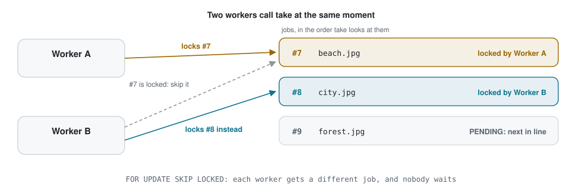
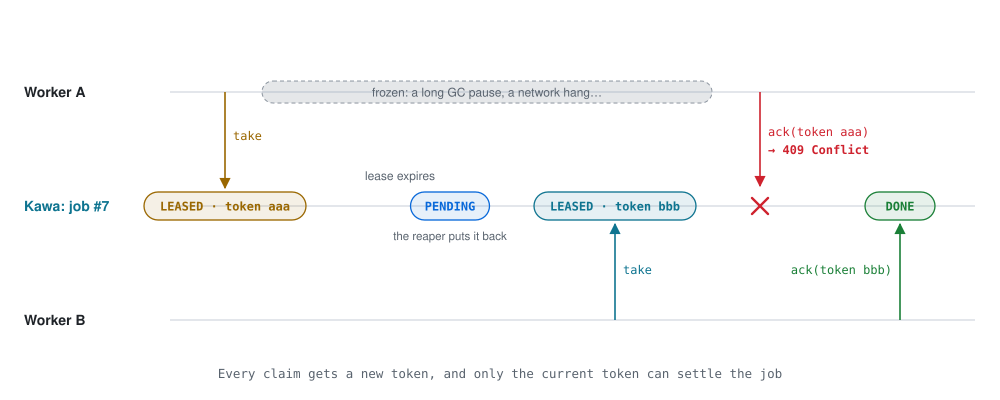
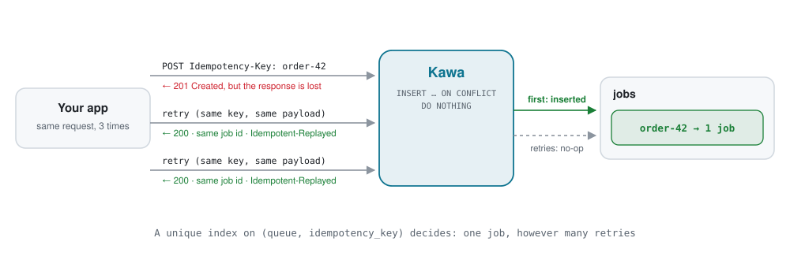

<div align="center">

# Kawa

**A durable job queue built on PostgreSQL.**<br>
Hand slow work to Kawa, run it in workers written in any language, and never lose a job to a crash.

[](https://github.com/sujal-taneja/kawa/actions/workflows/ci.yml)


[](LICENSE)

[Quickstart](#quickstart) · [Features](#features) · [Java client](#java-client) · [How it works](#how-it-works) · [Docs](#documentation)

</div>

---

**Kawa** (川, "river") takes slow or unreliable work off your request path.

- **Your app** (the *producer*) adds a job, such as "send this email" or "resize this image", with one HTTP call, and answers its user straight away.
- **Workers**, separate processes in any language, take jobs one at a time, do the work and report back.
- **Kawa** keeps every job safely in PostgreSQL in between. If a worker crashes mid-job, the job returns to the queue by itself. If a job keeps failing, it is set aside for inspection instead of retrying forever.

<p align="center">
  <picture>
    <source media="(prefers-color-scheme: dark)" srcset="docs/images/architecture-dark.svg">
    
  </picture>
</p>

## Quickstart

All you need is Docker.

```bash
git clone https://github.com/sujal-taneja/kawa.git && cd kawa
docker compose up -d        # Kawa + PostgreSQL; Kawa on http://localhost:8080
```

Then open **http://localhost:8080/swagger-ui/index.html** to try every endpoint from your browser, or drive a job through its whole life with `curl`: add it, take it, and report it done.

<p align="center">
  
</p>

<details>
<summary><b>The commands</b></summary>

```bash
# 1. your app adds a job
curl -X POST localhost:8080/api/v1/queues/emails/jobs \
  -H 'Content-Type: application/json' -d '{"payload": {"to": "ada@example.com"}}'

# 2. a worker takes it: the job comes back with a leaseToken
curl -X POST localhost:8080/api/v1/queues/emails/take

# 3. the worker reports success with that token
curl -X POST localhost:8080/api/v1/jobs/<id>/ack \
  -H 'Content-Type: application/json' -d '{"leaseToken": "<leaseToken>"}'
```

If port 8080 is taken, start Kawa with `KAWA_PORT=9090 docker compose up -d`.

</details>

## Features

**Reliability**
- **No job is handed out twice at once.** Workers claim jobs with `FOR UPDATE SKIP LOCKED`; a test releases 10 workers on 1,000 jobs and checks every job is claimed exactly once.
- **Crash recovery.** A claim is a lease with an expiry. If a worker dies, its job goes back on the queue.
- **Stale workers are fenced off.** Each lease has its own token, so a worker that froze past its lease can't finish a job someone else now holds.
- **Bounded retries.** A failed job is retried after a delay, up to `maxAttempts` (crashes count), then marked `DEAD` and kept for inspection.

**Scheduling**
- **Priorities** from 0 to 9, so urgent jobs jump the queue.
- **Delayed jobs** that run after a delay or at an exact time, up to a year ahead.
- **Idempotent enqueue.** Send an `Idempotency-Key` and retrying a request never creates a second job, even when the retries arrive together.

**Developer experience**
- **Plain HTTP and JSON**, documented with OpenAPI and Swagger UI, with errors in the RFC 9457 problem-details format.
- **A Java client** with a ready-made worker loop.
- **One command to run**, with Docker Compose.

## Java client

One library covers both halves of the system, which usually run as separate programs:

<table>
<tr>
<th width="50%">In your app: add jobs</th>
<th width="50%">In a worker: run them</th>
</tr>
<tr>
<td valign="top">

```java
var kawa = KawaClient.create(
    "http://localhost:8080");

kawa.enqueue("thumbnails",
    new Thumbnail("beach.jpg", 200));

kawa.enqueue("thumbnails",
    new Thumbnail("avatar.jpg", 64),
    EnqueueOptions.builder()
        .priority(9)          // jump the queue
        .delay(Duration.ofMinutes(5))
        .idempotencyKey("avatar-42")
        .build());
```

</td>
<td valign="top">

```java
var kawa = KawaClient.create(
    "http://localhost:8080");

var worker = KawaWorker
    .builder(kawa, "thumbnails")
    .onJob(Thumbnail.class,
        t -> resize(t.image(), t.width()))
    .build();

worker.start();

// Ctrl+C finishes the current job, then stops
Runtime.getRuntime()
    .addShutdownHook(new Thread(worker::stop));
```

</td>
</tr>
<tr>
<td valign="top">

`enqueue` returns as soon as the job is safely stored. The payload is any object Jackson can turn into JSON, such as a record. Options are optional: priority, a delay or exact run time, and an idempotency key that makes retries safe.

</td>
<td valign="top">

Your code runs once per job: **return** and the job is done, **throw** and it's retried later. Start as many workers as you like; they never get the same job.

</td>
</tr>
</table>

Here is the [Java quickstart](examples/java-quickstart) running for real: one producer and two workers. Worker A is killed with `kill -9` in the middle of `city.jpg`, and worker B finishes that job as attempt 2. Along the way, the priority-9 job jumps the queue, the delayed job waits its turn, and a corrupted image is retried once before it's marked `DEAD`.

<p align="center">
  
</p>

Java 17+, no Spring, and Jackson is its only dependency. The [Java client guide](docs/java-client.md) covers installation, every option and error handling.

## How it works

Every job is a row in one PostgreSQL table, and every change to a job is a single SQL statement. Five ideas carry the whole design.

### 1. A job's life

A job waits as `PENDING` (possibly scheduled for later), is `LEASED` to one worker at a time, and ends `DONE`, or `DEAD` once it runs out of attempts.

<p align="center">
  <picture>
    <source media="(prefers-color-scheme: dark)" srcset="docs/images/lifecycle-dark.svg">
    
  </picture>
</p>

### 2. Claiming without collisions

`take` locks the best ready job with `FOR UPDATE SKIP LOCKED`. Workers asking at the same moment each get a different job, and none of them waits for another.

<p align="center">
  <picture>
    <source media="(prefers-color-scheme: dark)" srcset="docs/images/claiming-dark.svg">
    
  </picture>
</p>

### 3. Fencing off stale workers

Every claim gets a fresh random lease token, and only the current token can settle the job. A worker that froze past its lease gets `409 Conflict` instead of overwriting the work of whoever holds the job now.

<p align="center">
  <picture>
    <source media="(prefers-color-scheme: dark)" srcset="docs/images/fencing-dark.svg">
    
  </picture>
</p>

### 4. Safe retries

A producer whose request timed out can't tell whether the job was created. With an `Idempotency-Key`, it can simply retry: a unique index lets only the first request create the job, and every retry gets the same job back.

<p align="center">
  <picture>
    <source media="(prefers-color-scheme: dark)" srcset="docs/images/idempotency-dark.svg">
    
  </picture>
</p>

### 5. Recovering from crashes

A reaper runs every few seconds. It puts jobs whose lease ran out back on the queue, which is how worker B got `city.jpg` in the demo above, and it marks a job `DEAD` once it is out of attempts.

### Guarantees

| | |
|---|---|
| **No lost jobs** | A job is acknowledged only after it is committed to PostgreSQL. |
| **One holder at a time** | At most one worker holds a valid lease on a job. |
| **No stuck jobs** | Every lease expires, and expired jobs return to the queue. |
| **Bounded retries** | A job runs at most `maxAttempts` times, crashes included. |
| **Exactly-once enqueue** | With an `Idempotency-Key`, retries never create a second job. |
| **At-least-once delivery** | A worker that crashes after the work but before reporting it causes a second run, so job handlers should be safe to repeat. |

The [architecture guide](docs/architecture.md) goes deeper, with the SQL behind each step.

## Documentation

| Guide | What's inside |
|---|---|
| [HTTP API](docs/api.md) | Endpoints, enqueue options, priorities, delays, idempotency, errors |
| [Java client](docs/java-client.md) | `KawaClient`, `KawaWorker`, exceptions, writing safe handlers |
| [Architecture](docs/architecture.md) | The data model, claiming, leases and fencing, the reaper, guarantees |
| [Development](docs/development.md) | Building, testing, running from source, configuration |

## Tech stack

Java 21 · Spring Boot 4 · PostgreSQL 16 · Flyway · springdoc-openapi · Maven · JUnit 5 · Testcontainers · Docker · GitHub Actions

## License

[Apache License 2.0](LICENSE)
