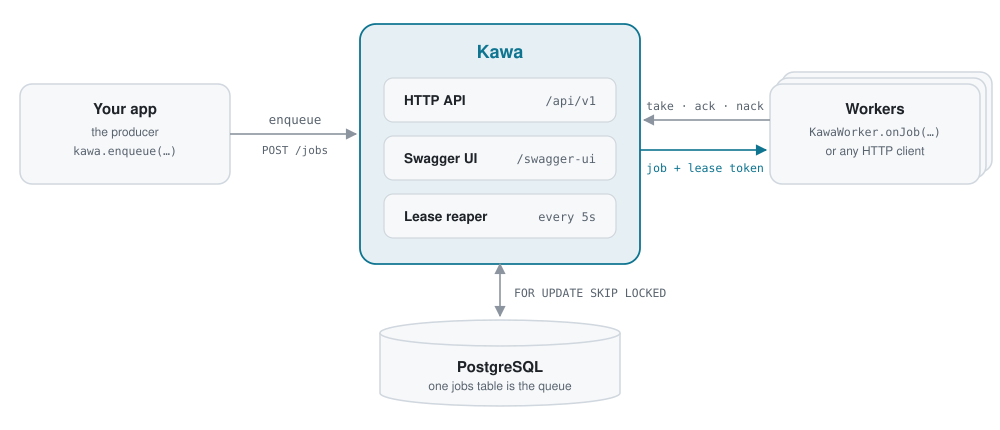
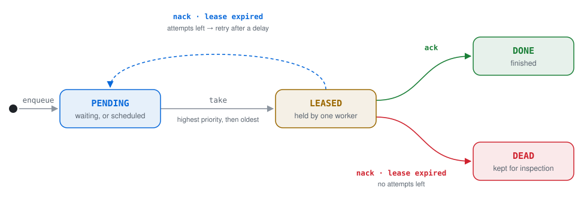

<div align="center">

# Kawa

**A durable job queue service built on PostgreSQL.**<br>
Lease-based at-least-once delivery, automatic crash recovery, and nothing to run besides Postgres.

[](https://github.com/sujal-taneja/kawa/actions/workflows/ci.yml)


[](LICENSE)

[Quickstart](#quickstart) · [How it works](#how-it-works) · [API](#api) · [Crash-recovery demo](#crash-recovery-demo) · [Roadmap](#roadmap)

</div>

---

**Kawa** (川, "river") takes slow or unreliable work off your request path. Your services enqueue *jobs* (send an email, resize an image, call a flaky API), and separate worker processes claim them over HTTP, run them, and report back. If a worker crashes mid-job, the job comes back on its own. If a job keeps failing, it is parked for inspection instead of retrying forever.

<p align="center">
  <picture>
    <source media="(prefers-color-scheme: dark)" srcset="docs/images/architecture-dark.svg">
    
  </picture>
</p>

## Highlights

- **No double delivery under load.** Claims use `FOR UPDATE SKIP LOCKED`, so concurrent workers never grab the same job. Proven by a 10-worker × 1000-job test.
- **Crash recovery built in.** Every claim is a time-limited lease. A reaper returns jobs from dead workers to the queue.
- **Fencing lease tokens.** A worker that stalls past its lease cannot ack a job that has since moved to another worker.
- **Bounded retries and dead jobs.** Failed jobs retry after a delay; after `maxAttempts` they are marked dead, including jobs that crash every worker.
- **Language-agnostic workers.** Anything that speaks HTTP + JSON can be a worker.

## How it works

<p align="center">
  <picture>
    <source media="(prefers-color-scheme: dark)" srcset="docs/images/lifecycle-dark.svg">
    
  </picture>
</p>

Every job is a row in a PostgreSQL `jobs` table. Its `status` moves through four states: `PENDING`, `LEASED`, and the two terminal states `DONE` and `DEAD`.

**Claiming without collisions.** `take` is one SQL statement: an `UPDATE` whose target row is chosen by `SELECT ... FOR UPDATE SKIP LOCKED LIMIT 1`. When many workers ask at once, each one locks a different row and skips rows locked by others. There is no double delivery, no worker waits behind another, and no external lock service.

**Leases and fencing tokens.** Every claim stamps the job with a fresh random `leaseToken` and a `leaseExpiresAt`. `ack`, `nack` and `extend` succeed only with the current token while the job is still leased; otherwise they return `409 Conflict`.

**The reaper.** A scheduled task returns jobs with expired leases to `PENDING`, or marks them `DEAD` if that was their last attempt. It is a single atomic `UPDATE`, so it is safe to run on every Kawa instance at once.

### Guarantees

| Guarantee | What it means |
|---|---|
| **No&nbsp;lost&nbsp;jobs** | A job is acknowledged to the producer only after it is committed to PostgreSQL. |
| **One&nbsp;holder&nbsp;at&nbsp;a&nbsp;time** | At most one worker holds a valid lease on a job. |
| **No&nbsp;stuck&nbsp;jobs** | Every lease expires, and expired jobs return to the queue. |
| **Bounded&nbsp;retries** | A job runs at most `maxAttempts` times, crashes included, then becomes dead. |
| **At&#8209;least&#8209;once&nbsp;delivery** | A job can run more than once (for example, a worker crashes after finishing but before acking), so handlers should be idempotent. |

## Quickstart

Requires **Java 21** and **Docker** (Docker Desktop, Colima, or any other engine).

```bash
docker compose up -d     # PostgreSQL 16 on localhost:5432
./mvnw spring-boot:run   # Kawa on localhost:8080; the schema is created on startup
```

Enqueue a job, claim it, and acknowledge it:

```bash
curl -X POST localhost:8080/api/v1/queues/emails/jobs \
  -H 'Content-Type: application/json' \
  -d '{"payload": {"to": "ada@example.com"}, "maxAttempts": 3}'
# {"id":"5f0c…"}

curl -X POST 'localhost:8080/api/v1/queues/emails/take?leaseSeconds=30'
# {"id":"5f0c…","payload":{"to":"ada@example.com"},"status":"LEASED","attempts":1,"leaseToken":"9b1e…", …}

curl -X POST localhost:8080/api/v1/jobs/5f0c…/ack \
  -H 'Content-Type: application/json' \
  -d '{"leaseToken": "9b1e…"}'
```

## API

All endpoints live under `/api/v1` and speak JSON.

| Method | Path | Body | Responses |
|---|---|---|---|
| `POST` | `/queues/{queue}/jobs` | `{"payload": {…}, "maxAttempts": 5}` | `201` with `{"id"}` |
| `POST` | `/queues/{queue}/take?leaseSeconds=30` | – | `200` with the job · `204` if nothing is ready |
| `POST` | `/jobs/{id}/extend` | `{"leaseToken", "seconds": 30}` | `204` · `409` if the lease is not held |
| `POST` | `/jobs/{id}/ack` | `{"leaseToken"}` | `204` · `409` |
| `POST` | `/jobs/{id}/nack` | `{"leaseToken", "seconds": 10}` | `204` (retry after `seconds`, or dead) · `409` |
| `GET` | `/jobs/{id}` | – | `200` with the job · `404` |

Defaults: `maxAttempts` 5, lease 30 s, retry delay 10 s. A queue exists as soon as a job is enqueued to it.

<details>
<summary><b>Example job</b></summary>

```json
{
  "id": "a122cf6c-0690-4442-8ca1-ad3a3adf2fe6",
  "queue": "emails",
  "payload": { "to": "ada@example.com" },
  "status": "LEASED",
  "attempts": 1,
  "maxAttempts": 3,
  "availableAt": "2026-10-23T06:38:19.474Z",
  "leaseToken": "ca6ef52b-d575-42da-8327-3d771c0052b9",
  "leaseExpiresAt": "2026-10-23T06:38:49.522Z",
  "createdAt": "2026-10-23T06:38:19.474Z",
  "updatedAt": "2026-10-23T06:38:19.522Z"
}
```

</details>

## Crash-recovery demo

[`examples/DemoWorker.java`](examples/DemoWorker.java) is a dependency-free worker: it takes a job, works on it for a few seconds, then acks it (payloads with `"fail": true` are nacked). Java runs it straight from source.

```bash
java examples/DemoWorker.java http://localhost:8080 demo worker-A 6 &
java examples/DemoWorker.java http://localhost:8080 demo worker-B 6 &

for n in 1 2 3; do
  curl -s -X POST localhost:8080/api/v1/queues/demo/jobs \
    -H 'Content-Type: application/json' -d "{\"payload\": {\"n\": $n}}"
done
```

Kill worker A with `kill -9` while it is mid-job. It never acks, its lease runs out, the reaper puts the job back, and worker B finishes it as attempt 2:

<p align="center">
  
</p>

## Testing

```bash
./mvnw verify
```

The suite runs against a real PostgreSQL started by [Testcontainers](https://testcontainers.com), so Docker must be running. It covers every state transition, lease-token checks, the reaper, and the HTTP API.

`ConcurrentTakeTest` releases 10 workers at once against 1000 jobs and asserts that every job is processed **exactly once**. Removing `FOR UPDATE SKIP LOCKED` from the claim query makes it fail.

<details>
<summary><b>Running the tests on Colima</b></summary>

Testcontainers needs two settings to work with Colima:

```bash
echo "docker.host=unix://$HOME/.colima/default/docker.sock" >> ~/.testcontainers.properties
export TESTCONTAINERS_DOCKER_SOCKET_OVERRIDE=/var/run/docker.sock   # add to your shell profile
```

</details>

## Configuration

Settings live in [`application.yml`](src/main/resources/application.yml) and can be overridden with environment variables or command-line flags.

| Property | Default | Meaning |
|---|---|---|
| `spring.datasource.url` | `jdbc:postgresql://localhost:5432/kawa` | PostgreSQL connection |
| `server.port` | `8080` | HTTP port |
| `kawa.reaper.interval-ms` | `5000` | How often expired leases are reclaimed |

## Design notes

- **Why PostgreSQL and not a broker?** Jobs, their status and their history live in one transactional store you probably already run. `SKIP LOCKED` makes it a correct concurrent queue, and every job stays queryable by id. Kawa is a job *service* (status, retries, dead jobs, and later priorities, per-tenant limits and redrive), not just a message pipe.
- **Plain SQL.** Queries go through Spring's `JdbcClient` with no ORM, because claim, settle and reap depend on exact SQL semantics.
- **Versioned schema.** Migrations are managed by Flyway and applied on startup.

## Roadmap

| Version | Scope | Status |
|---|---|---|
| **v0.1** | Enqueue, lease-based claiming, lease extension, ack/nack with retries, lease expiry, dead jobs | **Shipped** |
| v0.2 | Idempotency keys, delayed jobs, priorities, exponential backoff, long-polling | Planned |
| v0.3 | Multi-tenancy with per-tenant concurrency and rate limits | Planned |
| v0.4 | Java worker SDK, metrics, admin API, `kawactl` CLI | Planned |
| v0.5 | Transactional outbox events, signed webhooks, recurring jobs | Planned |
| v0.6 | Reference deployment on AWS with Terraform | Planned |
| v1.0 | Web dashboard, benchmarks | Planned |

## Tech stack

Java 21 · Spring Boot 4 · PostgreSQL 16 · Flyway · Maven · JUnit 5 · Testcontainers · GitHub Actions

## License

Licensed under the [Apache License 2.0](LICENSE).
