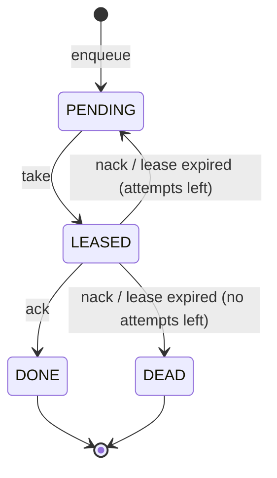

# Kawa

**Kawa** (川, "river") is a durable job queue service built on PostgreSQL.

Applications hand Kawa slow or unreliable work as *jobs*: send an email, resize an image, call a flaky API. Separate worker processes claim jobs over HTTP with a time-limited lease, run them, and acknowledge the result. If a worker crashes, its lease expires and the job is retried automatically. If a job keeps failing, it is parked as dead for inspection.

> **Status:** v0.1. The core queue works and is tested; the API may still change before 1.0.

## Guarantees

- **No lost jobs:** a job is acknowledged to the producer only after it is committed to PostgreSQL.
- **One holder at a time:** at most one worker holds a valid lease on a job. A worker whose lease has expired cannot ack, nack or extend it.
- **No stuck jobs:** every lease expires; expired jobs return to the queue.
- **Bounded retries:** a job runs at most `maxAttempts` times, then becomes dead. This includes attempts that end in a crash, so a job that kills every worker cannot loop forever.
- **At-least-once delivery:** a job may run more than once (for example, if a worker crashes after finishing but before acknowledging), so job handlers should be idempotent.

## How it works

PostgreSQL is both the store and the queue. Every job is a row in a `jobs` table, and its `status` moves through a small state machine:



**Claiming without collisions.** `take` is a single SQL statement: an `UPDATE` whose target row comes from a subquery using `SELECT ... FOR UPDATE SKIP LOCKED LIMIT 1`. When many workers ask at once, each one locks a different row and skips rows already locked by someone else, so there is no double delivery and no worker waits behind another. No external lock service is needed.

**Leases and lease tokens.** Every claim stamps the job with a fresh random `leaseToken` and a `leaseExpiresAt`. `ack`, `nack` and `extend` only succeed if they present the current token while the job is still leased. A worker that stalled past its lease, and whose job has since been handed to someone else, gets `409 Conflict` instead of silently finishing a job it no longer owns.

**The reaper.** A scheduled task runs every few seconds and returns jobs with expired leases to `PENDING`, or marks them `DEAD` if that was their last attempt. It is a single atomic `UPDATE`, so it is safe to run on every Kawa instance at once.

**Retries.** `nack` makes the job available again after a delay. Once `attempts` reaches `maxAttempts` the job becomes `DEAD` and stays in the table for inspection.

## Quickstart

Requirements: Java 21 and Docker (Docker Desktop, Colima, or any other Docker engine).

```bash
docker compose up -d     # PostgreSQL 16 on localhost:5432
./mvnw spring-boot:run   # Kawa on localhost:8080; the schema is created on startup
```

Enqueue a job, claim it, and acknowledge it:

```bash
curl -s -X POST localhost:8080/api/v1/queues/emails/jobs \
  -H 'Content-Type: application/json' \
  -d '{"payload": {"to": "ada@example.com"}, "maxAttempts": 3}'
# {"id":"5f0c..."}

curl -s -X POST 'localhost:8080/api/v1/queues/emails/take?leaseSeconds=30'
# {"id":"5f0c...","payload":{"to":"ada@example.com"},"status":"LEASED","attempts":1,"leaseToken":"9b1e...",...}

curl -s -X POST localhost:8080/api/v1/jobs/5f0c.../ack \
  -H 'Content-Type: application/json' \
  -d '{"leaseToken": "9b1e..."}'
```

## API

All endpoints are under `/api/v1` and speak JSON.

| Method | Path | Body | Result |
|---|---|---|---|
| `POST` | `/queues/{queue}/jobs` | `{"payload": {...}, "maxAttempts": 5}` | `201` `{"id": ...}` |
| `POST` | `/queues/{queue}/take?leaseSeconds=30` | none | `200` with the job, or `204` if nothing is ready |
| `POST` | `/jobs/{id}/extend` | `{"leaseToken": ..., "seconds": 30}` | `204`, or `409` if the lease is not held |
| `POST` | `/jobs/{id}/ack` | `{"leaseToken": ...}` | `204`, or `409` if the lease is not held |
| `POST` | `/jobs/{id}/nack` | `{"leaseToken": ..., "seconds": 10}` | `204` (retry after `seconds`, or dead), or `409` |
| `GET` | `/jobs/{id}` | none | `200` with the job, or `404` |

Defaults: `maxAttempts` 5, lease 30 seconds, retry delay 10 seconds. A queue exists as soon as a job is enqueued to it.

## Demo: crash recovery

[`examples/DemoWorker.java`](examples/DemoWorker.java) is a dependency-free worker that takes jobs, works on each for a few seconds, and acks them (payloads with `"fail": true` are nacked). Java runs it straight from source:

```bash
java examples/DemoWorker.java http://localhost:8080 demo worker-A 6 &
java examples/DemoWorker.java http://localhost:8080 demo worker-B 6 &

for n in 1 2 3; do
  curl -s -X POST localhost:8080/api/v1/queues/demo/jobs \
    -H 'Content-Type: application/json' -d "{\"payload\": {\"n\": $n}}"
done
```

While worker A is in the middle of a job, kill it with `kill -9`. It never acks, so its lease runs out, the reaper puts the job back, and worker B picks it up as attempt 2:

```
12:18:47 [worker-A] took a122cf6c… (attempt 1) payload={"n": 1}
                    (kill -9 worker-A)
12:18:59 [worker-B] took a122cf6c… (attempt 2) payload={"n": 1}
12:19:05 [worker-B] acked   a122cf6c…
```

## Testing

```bash
./mvnw verify
```

Tests run against a real PostgreSQL started by [Testcontainers](https://testcontainers.com), so Docker must be running. The suite covers every state transition, lease-token checks, the reaper, and the HTTP API.

`ConcurrentTakeTest` starts 10 workers against 1000 jobs and checks that every job is processed exactly once. Removing `FOR UPDATE SKIP LOCKED` from the claim query makes it fail.

> On Colima, set `TESTCONTAINERS_DOCKER_SOCKET_OVERRIDE=/var/run/docker.sock` and point Testcontainers at Colima's socket (`docker.host=unix://$HOME/.colima/default/docker.sock` in `~/.testcontainers.properties`).

## Configuration

Settings live in [`application.yml`](src/main/resources/application.yml) and can be overridden with environment variables or command-line flags.

| Property | Default | Meaning |
|---|---|---|
| `spring.datasource.url` | `jdbc:postgresql://localhost:5432/kawa` | PostgreSQL connection |
| `server.port` | `8080` | HTTP port |
| `kawa.reaper.interval-ms` | `5000` | How often expired leases are reclaimed |

## Design notes

- **Why PostgreSQL and not a broker?** Jobs, their status and their history live in one transactional store you probably already run. `SKIP LOCKED` makes it a correct concurrent queue, and every job remains queryable by id. Kawa is a job *service* (status, retries, dead jobs, and later priorities, per-tenant limits and redrive), not just a message pipe.
- **Plain SQL.** Queries go through Spring's `JdbcClient` with no ORM, because the claim, settle and reap logic depends on exact SQL semantics.
- **Schema migrations** are versioned with Flyway and applied on startup.

## Roadmap

- **v0.1:** enqueue, lease-based claiming, lease extension, ack/nack with retries, lease expiry, dead jobs ✅
- **v0.2:** idempotency keys, delayed jobs, priorities, exponential backoff, long-polling
- **v0.3:** multi-tenancy with per-tenant concurrency and rate limits
- **v0.4:** Java worker SDK, metrics, admin API, `kawactl` CLI
- **v0.5:** transactional outbox events, signed webhooks, recurring jobs
- **v0.6:** reference deployment on AWS with Terraform
- **v1.0:** web dashboard, benchmarks

## Tech stack

Java 21 · Spring Boot 4 · PostgreSQL 16 · Flyway · Maven · JUnit 5 · Testcontainers

## License

Licensed under the [Apache License 2.0](LICENSE).
